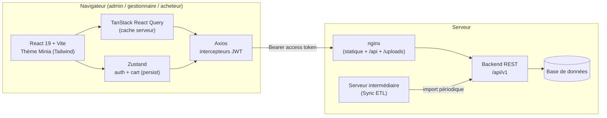
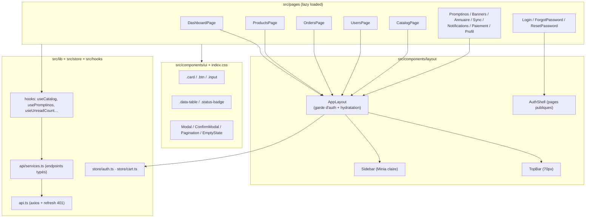
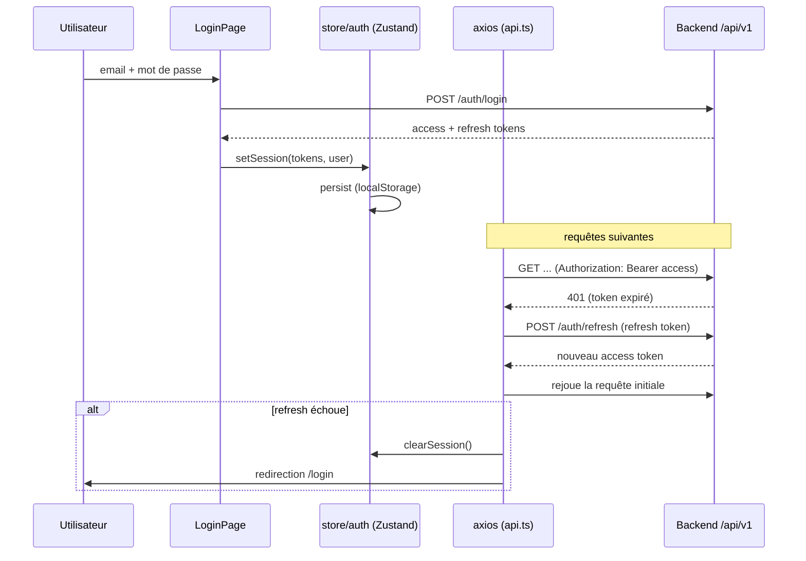
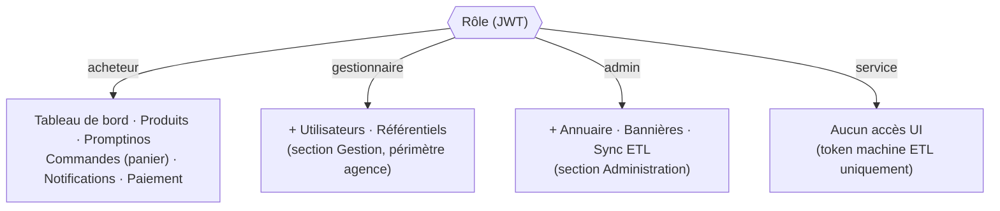
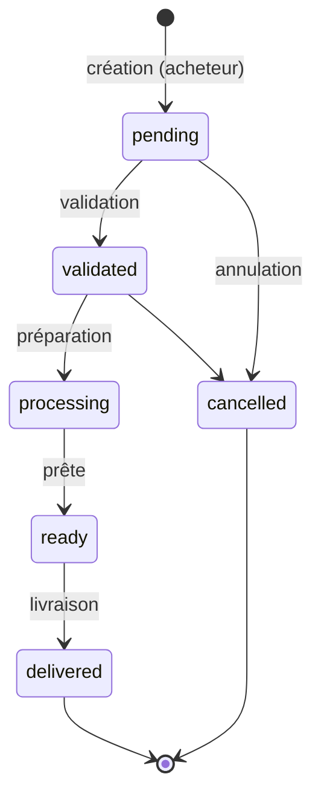

# Architecture — frontend admin v2

Frontend React 19 + TypeScript + Vite + Tailwind. Même backend et mêmes APIs que la v1 ;
seul le thème (Minia) diffère — voir [UI-V2-MINIA.md](UI-V2-MINIA.md).

## Vue d'ensemble

## Couches du frontend

## Flux d'authentification

## Navigation par rôle

- La liste est déclarée dans [src/lib/nav.ts](../src/lib/nav.ts) (`navSectionsForRole`).
- Les routes sont protégées par `AppLayout` (session) et `RequireRole` (rôle).

## Cycle de vie d'une commande (UI)

Chaque état a sa classe `.status-badge--*` (palette soft Minia) dans
[src/index.css](../src/index.css).
